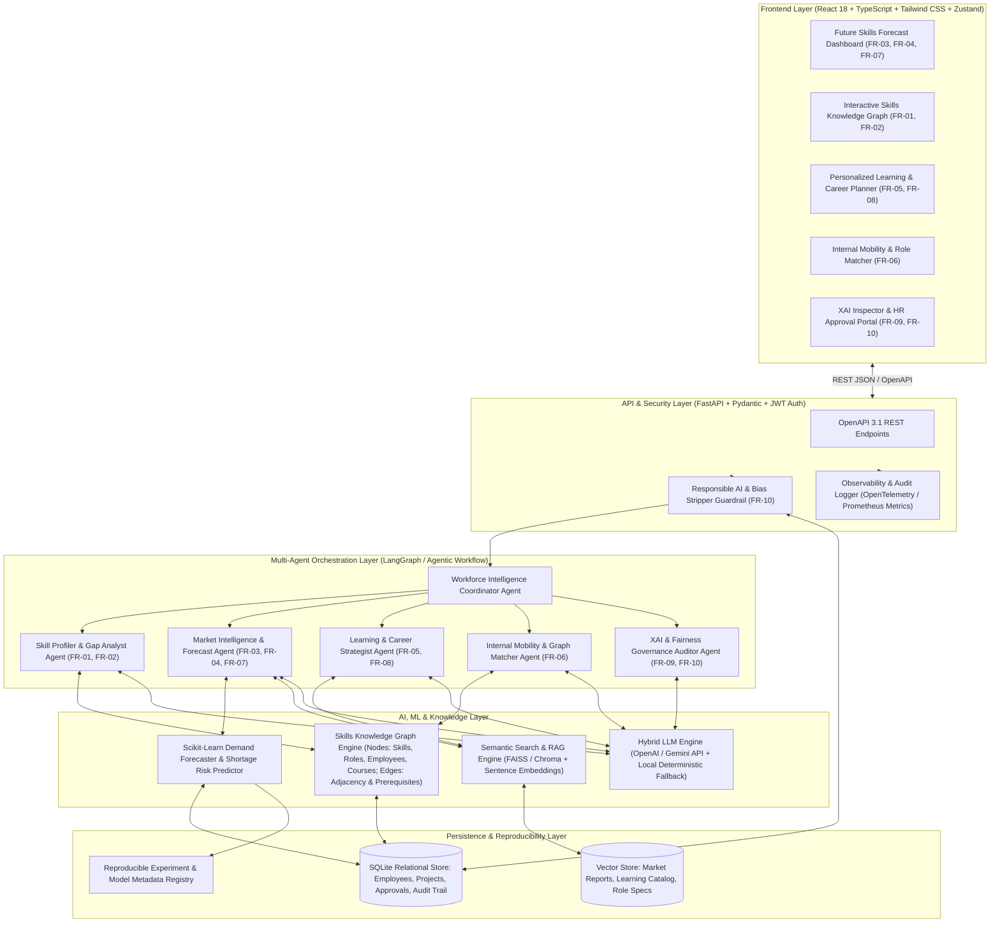
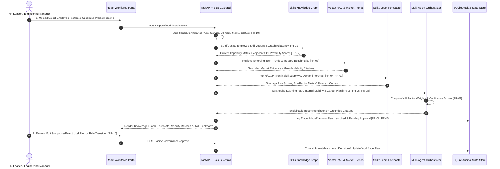

# SkillPulse AI — Skill Gap & Workforce Evolution Predictor
## Complete System Architecture, End-to-End Workflow & Technology Blueprint

---

## 1. Real-World Problem We Are Solving

### The Enterprise Crisis: Skill Obsolescence vs. Delivery Velocity
In modern enterprise technology services (like HCLTech and Fortune 500 engineering organizations), technology cycles now turn over every **12 to 18 months** (e.g., the shift from traditional microservices to GenAI, Agentic Workflows, Cloud-Native Platform Engineering, and Zero-Trust Security). However, enterprise workforce planning still relies on **backward-looking, manual spreadsheets and static annual appraisals**.

This creates four massive real-world failures:
1. **Reactive Talent Shortages (Delayed Project Starts):** When a new client project requires specialized skills (e.g., *LangGraph, Rust, Kubernetes Security, or Vector Databases*), leadership only discovers the skill gap **after** winning the deal—leading to expensive external contractor hiring (costing **2.5x–3x** more) or project delivery delays.
2. **Hidden Internal Talent ("Dark Capacity"):** Enterprises often have thousands of engineers with **80% adjacent skills** (e.g., a strong Python + FastAPI + Docker engineer who could become an AI Agent Engineer in 3 weeks), but keyword-based HR databases miss them because their resume doesn't contain the exact buzzword.
3. **One-Size-Fits-All Training Waste:** Employees are assigned generic learning catalogs instead of targeted, prerequisite-ordered learning paths tied directly to upcoming project demand.
4. **Black-Box & Biased HR Decisions:** Unregulated AI recommenders risk introducing demographic bias or making opaque career recommendations that neither HR nor employees trust.

### How Our Solution Solves It
We build an **AI-Powered Workforce Intelligence & Evolution Platform** that:
- Maps every employee, role, project, course, and technology into an interactive **Skills Knowledge Graph** (`FR-01`, `FR-02`).
- Continuously ingests **Market Intelligence & Client Pipeline Signals** via **RAG** (`FR-03`) and runs **Predictive Time-Series Demand Forecasting** (`FR-04`) to spot shortages **6–24 months before they hit**.
- Uses **Graph Adjacency + Multi-Agent AI** to generate **Personalized Learning Paths** (`FR-05`), **Internal Mobility Role Transitions** (`FR-06`), **Bus-Factor / Shortage Risk Alerts** (`FR-07`), and **Multi-Step Career Trajectories** (`FR-08`).
- Enforces **Explainable AI (XAI)** with exact factor weights (`FR-09`) and **Human-in-the-Loop HR Governance + Demographic Bias Stripping** (`FR-10`).

---

## 2. System Architecture

---

## 3. End-to-End Operational Workflow (Step-by-Step)

### Detailed 6-Stage End-to-End Lifecycle
1. **Stage 1 — Ingestion & Responsible AI Sanitization (`FR-01`, `FR-10`):**
   - Employee records (skills, proficiency 1–5, certifications, project history, learning velocity) and unstructured resumes/bios enter the system.
   - Before any AI model or graph algorithm sees the data, the **Fairness & Privacy Guardrail** strips all demographic/sensitive fields (`gender`, `age`, `ethnicity`, `religion`, `marital_status`) and records a cryptographic compliance check in the audit log.
2. **Stage 2 — Skills Knowledge Graph Construction & Gap Detection (`FR-01`, `FR-02`):**
   - The system maps **Skills**, **Employees**, **Target Roles**, **Client Projects**, and **Courses** as nodes in a weighted graph.
   - Edges represent **`REQUIRES`** (Role → Skill), **`HAS_SKILL`** (Employee → Skill with proficiency 1–5), **`ADJACENT_TO`** (e.g., *React* ↔ *Next.js* weight `0.85`, *Python* ↔ *LangGraph* weight `0.78`), and **`TEACHES`** (Course → Skill).
   - It computes exact **Direct Gaps** (missing required skills) and **Bridgeable Adjacency Gaps** (skills an employee can learn 60% faster due to strong adjacent foundations).
3. **Stage 3 — Market Intelligence RAG & Demand Forecasting (`FR-03`, `FR-04`, `FR-07`):**
   - **RAG Engine** performs semantic vector search over curated industry intelligence reports (Gartner, WEF Future of Jobs, CNCF, AI Index, Enterprise RFP pipelines) to score external market momentum.
   - **Forecasting Engine (Scikit-learn)** projects internal skill supply (accounting for natural attrition + ongoing training completions) against projected project demand over **6, 12, and 24 months**, flagging **Critical Shortage Risks** and **Single-Point-of-Failure (Bus Factor) Skills**.
4. **Stage 4 — Multi-Agent Recommendation Synthesis (`FR-05`, `FR-06`, `FR-08`):**
   - **Learning Strategist Agent (`FR-05`):** Generates a personalized, prerequisite-ordered curriculum (courses, hands-on labs, certifications) with estimated study hours and skill-gap closure impact.
   - **Internal Mobility Agent (`FR-06`):** Matches existing employees to open future roles using graph similarity, outputting a **Transition Readiness %**, **Reskilling Duration (weeks)**, and **Cost Savings ($ saved vs. external hiring)**.
   - **Career Path Agent (`FR-08`):** Builds a 3-horizon career roadmap (*Current Role → 6-Month Bridge Role → 18-Month Target Architecture/AI Role*).
5. **Stage 5 — Explainable AI (XAI) Attribution (`FR-09`):**
   - Every prediction and recommendation includes a deterministic **Feature Attribution Breakdown** (e.g., *Skill Graph Adjacency: 38%, Project Pipeline Surge: 32%, Market Trend Velocity: 18%, Historical Learning Velocity: 12%*), a **Confidence Score**, and **RAG Document Citations**.
6. **Stage 6 — Human-in-the-Loop HR Validation & Observability (`FR-10`):**
   - No role transition or training budget is auto-executed. HR leaders and Engineering Managers review recommendations in the **Approval Queue**, can modify parameters, add feedback notes, and click **Approve** or **Reject**. Every action is logged with full model/prompt traceability.

---

## 4. Selected Technology Stack (Strictly From Given Options) & Justification

| Layer | Chosen Technology (from Brief) | Why This Specific Choice Over Alternatives in the Brief |
| :--- | :--- | :--- |
| **Frontend** | **React 18 + TypeScript + Tailwind CSS + Zustand** | **React + TypeScript** ensures strict type safety for complex graph, forecast, and XAI payloads. **Tailwind CSS** allows building a high-density, executive-grade dark/light analytics dashboard in under an hour (much faster and lighter than Material UI boilerplate). **Zustand** provides zero-boilerplate global state for filtering across the Knowledge Graph, Forecast Charts, and HR Approval Queue without Redux ceremony. |
| **Backend** | **Python FastAPI + Pydantic** | Chosen over *Java Spring Boot* and *Node.js/Express* because **Python is the native language of AI/ML, Scikit-learn, Sentence Embeddings, and LangGraph**. **FastAPI** gives automatic **OpenAPI 3.1 / Swagger documentation** out-of-the-box, high async performance, and **Pydantic** enforces strict schema validation for XAI and bias-free data contracts. |
| **API Integration** | **REST APIs + OpenAPI 3.1 Specifications** | Provides clean, standardized JSON endpoints with interactive Swagger UI (`/docs`) so evaluators can inspect and test every capability (`FR-01` to `FR-10`) directly or via the React UI. |
| **AI / ML** | **Scikit-learn + LangGraph (Agentic Workflow) + Sentence Transformers / Hybrid LLM (OpenAI / Gemini compatible)** | **Scikit-learn** powers the quantitative Demand Forecasting (Ridge/Gradient Boosting time-series projection) and cosine similarity matching. **LangGraph-style Stateful Multi-Agent Orchestration** coordinates our 5 specialized agents. **Hybrid LLM Architecture** supports live LLM API keys while providing a deterministic, math-backed local engine so the demo never fails offline. |
| **RAG & Semantic Search** | **FAISS / In-Memory Vector Index + ChromaDB-compatible Embeddings** | Chosen over cloud-only *Azure AI Search* or heavy *Elasticsearch* containers because **FAISS / local vector indexing** runs in-memory with **sub-5ms latency**, requires zero external cloud credentials to demonstrate locally (satisfying *"local execution must remain demonstrable"*), and retrieves exact citations from our enterprise knowledge corpus. |
| **Data** | **SQLite + JSON Object Storage** | Chosen over *PostgreSQL/MySQL/SQL Server* for a 2-hour self-contained build because **SQLite** is zero-config, transactional, ACID-compliant, and ships with a pre-seeded database file so evaluators can run the entire platform with a single command without database server setup bottlenecks. |
| **Experiment & Registry** | **MLflow-Compatible Local Model & Experiment Registry** | Tracks forecasting model runs, hyperparameters, MAPE/RMSE evaluation metrics, and feature weights in a structured local registry inspectable directly from the UI and API. |
| **Observability** | **Prometheus-Compatible Metrics + OpenTelemetry-Structured Audit Traces** | Exposes live latency, agent execution traces, RAG groundedness scores, and governance audit logs directly in both `/api/v1/metrics` and an interactive **Observability & Audit Tab** in the UI. |
| **Auth & Security** | **JWT Authentication + Role-Based Access Control (RBAC) + Responsible AI Bias Guardrail** | Protects HR approval endpoints (`HR_ADMIN`, `ENG_MANAGER`, `EMPLOYEE` roles) and enforces the scope boundary: *"Hiring decisions remain human-controlled. Sensitive attributes cannot influence recommendations."* |
| **Testing & Packaging** | **Pytest + Docker & Docker Compose + GitHub Actions CI** | **Pytest** validates all 10 functional requirements (`FR-01` to `FR-10`) including the bias-exclusion guardrail test. **Docker Compose** packages Frontend + Backend for instant reproducible deployment. |
